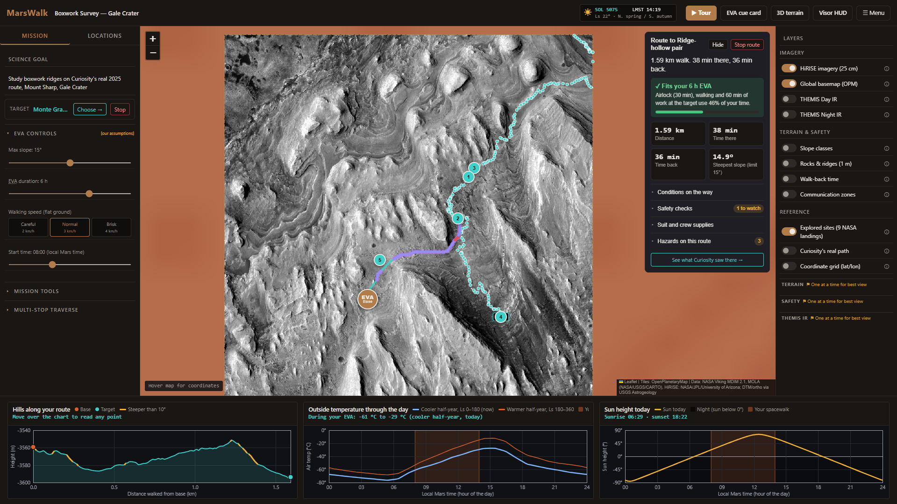
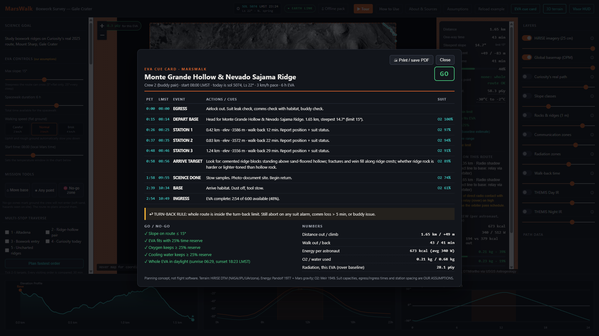
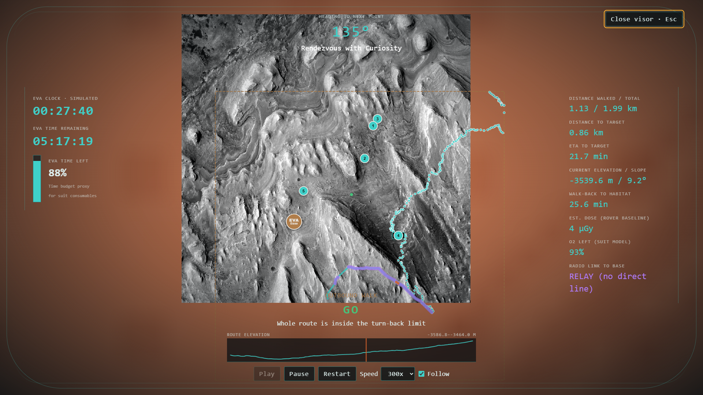

# MarsWalk: walk Mars safely

**NASA Space Apps Challenge 2026** · Challenge: *Interplanetary Survival Guide: Martian Map* · Team: **Dark Matter Devs**

MarsWalk is an installable, offline EVA planner for the first humans on Mars. It is built on the real place where NASA's Curiosity rover studied boxwork ridges in 2025–2026, on Mount Sharp in Gale Crater. It layers data from four NASA missions at walking scale. It then plans a safe route, checks the crew's oxygen, cooling water, radiation, daylight and turn-back point, prints an astronaut cue card, and replays the walk in a helmet-visor HUD.

**Live app:** https://scopemint.github.io/marswalk/ (install it from the browser's address bar; it then works with no network)

**Demo video (30 s, English captions):** [`media/marswalk-demo-30s.mp4`](media/marswalk-demo-30s.mp4) · subtitles [`media/marswalk-demo-30s.srt`](media/marswalk-demo-30s.srt)

| EVA cue card | Visor HUD | 3D fly-through |
|---|---|---|
|  |  |  |

---

## Why
Today's Mars maps (JPL Mars Trek, USGS geologic maps) are built for global and regional views. A human EVA is a few kilometres on foot, in a pressurised suit, against a clock. Nobody has layered the data at that scale and turned it into decisions: *which way do I walk, how long does it take, how much oxygen will it cost, and when must I turn back?*

## What makes it real
| | |
|---|---|
| **Real site** | 4 km × 4 km box on Curiosity's actual 2025–26 boxwork traverse (4.81° S, 137.37° E). |
| **Real terrain** | HiRISE Digital Terrain Model, **1 m/pixel**, turned into 160,000 route cells of 10 m. |
| **Validated** | Our terrain matches the elevations **Curiosity itself reported at 227 stops** within **2.4 m RMS**, after a constant 12.8 m datum offset. This check is computed live in the app. |
| **Real targets** | Science targets sit where Curiosity actually parked on the drill sols: Altadena (sol 4571), the Monte Grande hollow and Nevado Sajama ridge pair (sols ~4695–4718), the boxwork entry (sol 4548), and the rover's latest position (sol 5073). A fifth target is an unvisited boxwork field we found in HiRISE images. |
| **Real photos** | Curiosity Navcam and Mastcam frames from the sol the rover stood at each target. |
| **Real time** | Live Mars clock (NASA GISS Mars24 algorithm): today's Curiosity sol, local Mars time, season, sunrise and sunset at the site. Covered by 80 passing tests. |

## Features
- **Layered map:** HiRISE 25 cm imagery, slope classes, 1 m rock & ridge relief ("boulder" layer), THEMIS day and night thermal IR, Curiosity's real path, radio line-of-sight, relative radiation, walk-back time.
- **Route planner:** fastest walkable path under a slope limit you choose. It slows on uphill and rocky ground and runs in a Web Worker (~100 ms).
- **Multi-stop traverse:** tick 2–5 targets. MarsWalk times every leg on the real terrain, compares every visiting order and loads the fastest Base → stops → Base traverse. The safety card, suit model, HUD and cue card all cover the full traverse.
- **Mission tools:** move the base (slope-checked), route to any point on the map, and draw no-go zones that the route re-plans around.
- **Hazard call-outs:** distance ranges where the route loses direct radio contact with base (line of sight over the terrain), crosses rocky ground, or nears the slope limit.
- **Safety card:** distance, time, steepest slope, climb, walk-back time, EVA budget, turn-back point, radiation (Curiosity RAD), temperature (REMS), GO / NO-GO checks.
- **Suit & crew model:** walking energy from the Pandolf (1977) equation scaled to Mars gravity. It gives oxygen (Weir 1949), CO₂ and sublimator cooling water against suit capacity, with Mars-vs-Earth comparison and buddy-pair totals.
- **EVA cue card:** a printable timeline in the style of an astronaut wrist checklist. It covers PET and local Mars time, stations, oxygen left, the turn-back rule, and a GO / NO-GO verdict including a daylight check.
- **Visor HUD:** a full-screen helmet view that replays the walk with EVA clock, consumables, ETA, heading, walk-back time and point-of-no-return countdown.
- **3D terrain:** HiRISE terrain in 3D with the route, targets and rover path draped on it, plus a fly-the-route camera.
- **Guided tour:** a ▶ Tour button plays a 45-second captioned walkthrough.
- **Installable and offline:** a Progressive Web App with a service worker. The "Offline pack" stores all 865 HiRISE tiles, because there is no internet on Mars.

## Data (NASA missions: MRO, Mars Odyssey, MSL/Curiosity, MGS/Viking)
| Layer | Source | Resolution |
|---|---|---|
| Elevation, slope, relief | HiRISE DTM `DTEEC_019698_1750_019988_1750_U01` (MRO) via USGS Astrogeology | 1 m |
| Imagery | HiRISE orthoimage `ESP_019988_1750` (MRO) | 0.25 m |
| Thermal | THEMIS Day/Night IR controlled mosaics (Mars Odyssey) via NASA Mars Trek | 100 m |
| Rover path, positions | Curiosity MMGIS traverse + waypoints (NASA/JPL) | per drive |
| Surface photos | Curiosity Navcam / Mastcam raw images | — |
| Radiation | Curiosity RAD surface dose (Hassler et al. 2014, *Science*) | site |
| Temperature | Curiosity REMS daily record (NASA Mars / CAB) | site |
| Context basemap | Viking MDIM 2.1 + MOLA (OpenPlanetaryMap) | 232 m |

Every source, link and licence is listed in [`docs/SOURCES.md`](docs/SOURCES.md) and in the app's **About & Sources** panel. Every number that is our own planning guess is labelled **OUR ASSUMPTION** on screen and in `src/js/config.js`.

## Desktop app (Windows)
Download from **[Releases](https://github.com/ScopeMint/marswalk/releases/latest)**:
- `MarsWalk-1.0.0-setup.exe`: installer with desktop and Start-menu shortcuts
- `MarsWalk-1.0.0-portable.exe`: runs without installing

It is the same app in its own window, fully offline. Maps, terrain, 3D and routing all run from files bundled in the app; only the global context basemap outside the study area needs a network. Build it yourself with `cd desktop && npm install && npm run dist`. It is built with Electron.

## Run it
- **Online:** open the live link. Use **Install app** in the header to add it to your desktop, phone or tablet.
- **Locally:** `python -m http.server 8080 --directory src`, then open http://localhost:8080. A local server is needed for the data files.
- **Rebuild the data:** `python scripts/08_build_real_site.py`, then `09_get_themis.py`, `04_make_overlays.py`, `generate_los_overlay.py`, `generate_rad_overlay.py`, `10_make_app_assets.py`, `11_make_3d_texture.py`. These need `rasterio`, `numpy`, `scipy` and `Pillow`, and read only the needed window from NASA/USGS cloud-optimised files.
- **Tests:** `node tests/marsclock.test.js`

## Honest limits
This is a planning concept, not flight software. Rocks smaller than ~2 m are not resolved; they show only as extra relief. Soil strength, live weather and solar-storm forecasts are not modelled. The radiation figure is the rover's surface baseline, not the dose inside a suit. Suit capacities are generic planning values.

## AI use
Claude Code (Anthropic) wrote most of the application code and data scripts. OpenAI Codex wrote the visor HUD, the Mars24 clock module and the 3D terrain view from written specifications. The team chose the concept, the site and the targets, checked the sources and tested the app. No AI-generated images or video were used; every picture is NASA data or a screenshot. Full log: [`docs/AI_USE.md`](docs/AI_USE.md).

## License
MIT. See [`LICENSE`](LICENSE). NASA data are public domain or CC0 as listed in `docs/SOURCES.md`.
