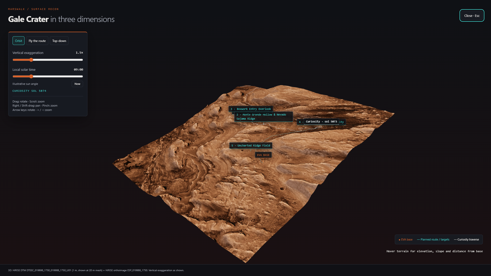

# MarsWalk: walk Mars safely

**NASA Space Apps Challenge 2026** · Challenge: *Interplanetary Survival Guide: Martian Map* · Team: **Dark Matter Devs**

MarsWalk is an EVA (spacewalk) planner for the first humans on Mars. It is built on the real place where NASA's Curiosity rover studied boxwork ridges in 2025–2026, on Mount Sharp in Gale Crater. You pick a science target. MarsWalk finds a safe walking route on real terrain, tells you if the walk fits your time, and shows the weather, the radiation and how fast you could reach shelter in a solar storm. Then you can walk the route in first person before you go.

It uses data from five NASA missions: Mars Reconnaissance Orbiter, Mars Odyssey and Curiosity for the science layers, and Viking and Mars Global Surveyor for the whole-planet basemap.

**Live app:** https://scopemint.github.io/marswalk/ (it can be installed from the browser's address bar, and then works with no network)

| EVA cue card | Visor HUD | 3D fly-through |
|---|---|---|
|  |  |  |

---

## Why
Today's Mars maps (JPL Mars Trek, USGS geologic maps) are built for global and regional views. A human EVA is a few kilometres on foot, in a pressurised suit, against a clock. Nobody has layered the data at that scale and turned it into decisions: *which way do I walk, how long does it take, how much oxygen will it cost, and when must I turn back?*

## How it works
The app opens on the whole planet, with every NASA landing site marked. **Go to Study Spot** flies you to our 4 km × 4 km study area in Gale Crater. From there the app is five pages, in the order you would plan a walk:

| Page | What you do there |
|---|---|
| **1 Plan route** | Pick a science target and set your limits: steepest slope, EVA length, walking speed and start time. The route draws itself and a route card says if it fits. |
| **2 Map layers** | Turn the NASA data layers on and off over the route: imagery, slope, rocks and ridges, day and night heat maps, Curiosity's path, radio line of sight. |
| **3 Weather** | Air temperature during your walk, daylight, the radiation dose estimate, and the Mars time and season at the site right now. |
| **4 Solar storms** | A storm drill for your walk, and the real storms Curiosity measured on the ground. |
| **5 Summary** | The whole plan on one page. |

A **▶ Tour** button plays a 45-second captioned walkthrough of all of this.

## Features
**Plan**
- **Route planner:** the fastest walkable path under the slope limit you choose. It slows down on uphill and rocky ground and runs in a Web Worker (~100 ms).
- **Route card:** distance, time there and back, steepest slope, whether the walk fits your EVA, and how much longer the safe route is than a straight line.
- **Safety checks:** climb, walk-back time, EVA budget, turn-back point, radiation, temperature and daylight, each with a GO / NO-GO result.
- **Suit and crew model:** walking energy from the Pandolf (1977) equation scaled to Mars gravity. It gives oxygen (Weir 1949), CO₂ and cooling water against suit capacity, with a Mars-vs-Earth comparison and buddy-pair totals.
- **Multi-stop traverse:** tick 2–5 targets. MarsWalk times every leg on the real terrain, compares every visiting order and loads the fastest Base → stops → Base traverse.
- **Mission tools:** move the base (slope-checked), route to any point on the map, and draw no-go zones that the route re-plans around.
- **Hazard call-outs:** the parts of the route that lose direct radio contact with base, cross rocky ground, or come near the slope limit.

**Know the conditions**
- **Layered map:** HiRISE 25 cm imagery, slope classes, 1 m rock and ridge relief, THEMIS day and night thermal IR, Curiosity's real path, radio line of sight and walk-back time.
- **Weather:** hourly air temperature from Curiosity's REMS station, sunrise and sunset from the live Mars clock, and a radiation dose estimate from Curiosity's RAD instrument.
- **Solar storm drill:** drag a slider to choose when the alert comes. The app shows which part of the EVA you are in, how long until you are inside, and how that compares with NASA's 2-hour figure for ending an EVA and reaching shelter. The route card shows the worst moment of your walk.
- **Real storms:** the storms Curiosity's RAD measured on the surface, including September 2017 (2 to 3 times the normal level) and May 2024 (8,100 μGy, the biggest RAD has measured).
- **Whole-Mars view:** every NASA lander and rover site with its landing point and mission facts, plus a search box for Mars locations.

**See it and take it with you**
- **3D terrain:** the HiRISE terrain in 3D with the route, targets and rover path draped on it, plus a fly-the-route camera.
- **First-person walk:** walk the route at eye level on the real terrain shape. Press **W A S D** to leave the route and walk anywhere, drag to look around.
- **Visor HUD:** a full-screen helmet view that replays the walk with EVA clock, consumables, ETA, heading, walk-back time and point-of-no-return countdown.
- **EVA cue card:** a printable timeline in the style of an astronaut wrist checklist, with local Mars time, stations, oxygen left, the turn-back rule and a GO / NO-GO verdict.
- **Rover check:** runs our planner between Curiosity's real stops and compares it with the drive the rover actually made.
- **Installable and offline:** a Progressive Web App with a service worker. The "Offline pack" stores all 865 HiRISE tiles, because there is no internet on Mars.

## What makes it real
| | |
|---|---|
| **Real site** | 4 km × 4 km box on Curiosity's actual 2025–26 boxwork traverse (4.81° S, 137.37° E). |
| **Real terrain** | HiRISE Digital Terrain Model, **1 m/pixel**, turned into 160,000 route cells of 10 m. |
| **Validated** | Our terrain matches the elevations **Curiosity itself reported at 227 stops** within **2.4 m RMS**, after a constant 12.8 m datum offset. This check is computed live in the app. |
| **Real targets** | Science targets sit where Curiosity actually parked on the drill sols: Altadena (sol 4571), the Monte Grande hollow and Nevado Sajama ridge pair (sols ~4695–4718), the boxwork entry (sol 4548), and the rover's latest position (sol 5073). A fifth target is an unvisited boxwork field we found in HiRISE images. |
| **Real photos** | Curiosity Navcam and Mastcam frames from the sol the rover stood at each target. |
| **Real time** | Live Mars clock (NASA GISS Mars24 algorithm): today's Curiosity sol, local Mars time, season, sunrise and sunset at the site. Covered by 80 passing tests. |
| **Real storms** | Solar storm numbers are Curiosity RAD measurements published by NASA/JPL, not our estimates. |

## How we know the numbers are right
| Check | Result | How to repeat it |
|---|---|---|
| Terrain vs Curiosity | 227 rover stops agree with our elevation grid to **2.4 m RMS** (after a 12.8 m datum offset) | computed live in the app (About panel) |
| Slope grid | 500 random cells recomputed by hand match `slope.bin` exactly; Horn's 3x3 method would differ by a median of 0.35° | `python scripts/14_check_slope.py` |
| Planner vs the rover | Run between Curiosity's real stops, our planner connects **17 of 19** legs at 15° and **19 of 19** at 20° and 25° | Menu → Rover check |
| Energy | Our Pandolf average for target 5 is about 280 kcal/h; measured Skylab and Apollo-era EVA rates were 100-500 kcal/h (Waligora & Horrigan 1974) | About panel, "Energy: reference check" |
| Data files | Radiation 210 ± 40 μGy/day (Hassler et al. 2014); hourly air temperature from NASA PDS REMS; 44 automatic checks pass | `python scripts/07_check_data.py` |

Every source, with a checked link, is in [`docs/SOURCES.md`](docs/SOURCES.md). Our own guesses are labelled OUR ASSUMPTION in the app (Menu → Assumptions lists all of them).

## Data (NASA missions: MRO, Mars Odyssey, MSL/Curiosity, Viking, MGS)
| Layer | Source | Resolution |
|---|---|---|
| Elevation, slope, relief | HiRISE DTM `DTEEC_019698_1750_019988_1750_U01` (MRO) via USGS Astrogeology | 1 m |
| Imagery | HiRISE orthoimage `ESP_019988_1750` (MRO) | 0.25 m |
| Thermal | THEMIS Day/Night IR controlled mosaics (Mars Odyssey) via NASA Mars Trek | 100 m |
| Rover path, positions | Curiosity MMGIS traverse + waypoints (NASA/JPL) | per drive |
| Surface photos | Curiosity Navcam / Mastcam raw images | — |
| Radiation | Curiosity RAD surface dose, 210 ± 40 μGy/day (Hassler et al. 2014, *Science*) | site |
| Solar storms | Curiosity RAD storm measurements (NASA/JPL news 2017, 2021, 2024; Zeitlin et al. 2018, *Geophys. Res. Lett.*); shelter timing from NASA-STD-3001 | site |
| Temperature | Curiosity REMS hourly air temperature (NASA PDS MODRDR; Gómez-Elvira et al. 2012) | site |
| Context basemap | Viking MDIM 2.1 + MOLA (OpenPlanetaryMap) | 232 m |

Every source, link and licence is listed in [`docs/SOURCES.md`](docs/SOURCES.md) and in the app's **About & Sources** panel. Every number that is our own planning guess is labelled **OUR ASSUMPTION** on screen and in `src/js/config.js`.

## Desktop app (Windows)
Download from **[Releases](https://github.com/ScopeMint/marswalk/releases/latest)**:
- `MarsWalk-1.0.0-setup.exe`: installer with desktop and Start-menu shortcuts
- `MarsWalk-1.0.0-portable.exe`: runs without installing

It is the same app in its own window, fully offline. Maps, terrain, 3D and routing all run from files bundled in the app; only the global context basemap outside the study area needs a network. Build it yourself with `cd desktop && npm install && npm run dist`. It is built with Electron.

## Run it
- **Online:** open the live link, https://scopemint.github.io/marswalk/. Use **Install app** in the header to add it to your desktop, phone or tablet.
- **Locally:** `python -m http.server 8080 --directory src`, then open http://localhost:8080. A local server is needed for the data files.
- **Rebuild the data:** `python scripts/08_build_real_site.py`, then `09_get_themis.py`, `04_make_overlays.py`, `generate_los_overlay.py`, `05_prepare_rems.py` (real REMS temperatures from NASA PDS, ~1 h first run), `06_prepare_rad.py`, `10_make_app_assets.py`, `11_make_3d_texture.py`. These need `rasterio`, `numpy`, `scipy` and `Pillow`, and read only the needed window from NASA/USGS cloud-optimised files.
- **Tests:** `node tests/marsclock.test.js`

## AI use
MarsWalk was designed, directed and verified by our team, using AI coding assistants as development tools. We wrote the specifications: the science goal, the site, the targets, the route and safety model, and the specifications of the NASA datasets we used. Claude Code and OpenAI Codex, and GitHub Copilot then generated most of the code and data scripts sourced from them.We treated every AI output as a draft to check. We tested each feature in the browser, then checked numbers against the original papers and NASA archives. That review caught real problems: an unsupported radiation value, an invented solar-storm multiplier and a wrong temperature citation. We replaced each one with verified data. A full log of AI-assisted files is in docs/AI_USE.md. All images are real NASA data; no AI-generated images or video.

## License
MIT. See [`LICENSE`](LICENSE). NASA data are public domain or CC0 as listed in `docs/SOURCES.md`.
